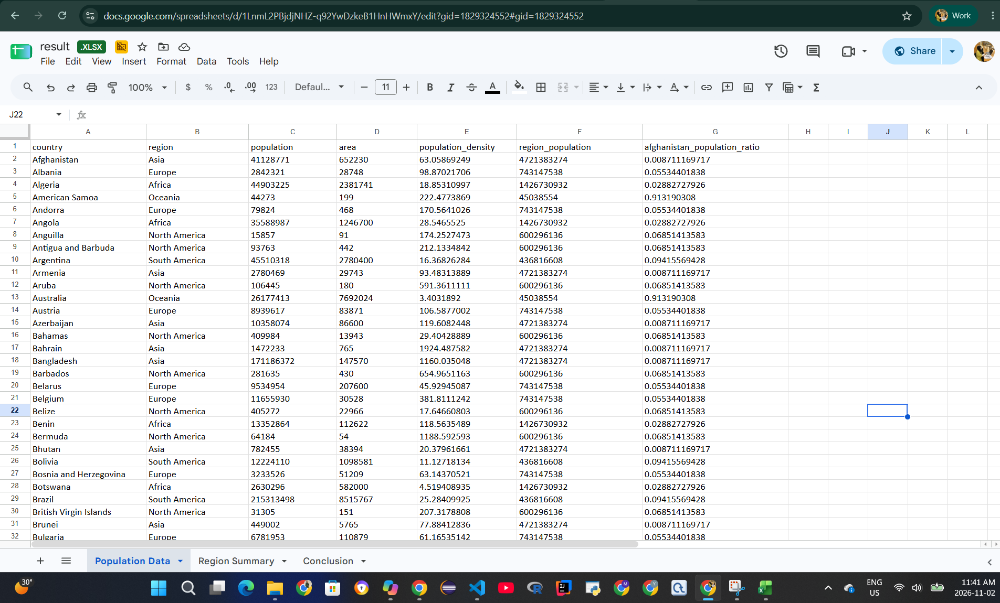

# Afghanistan Population Analysis

This project uses Python and pandas to compare Afghanistan's population with regional totals. It combines population and area datasets, calculates population density, and saves the analysis to an Excel workbook.

## What the script does

Run `assignment.py` to perform the assignment steps:

1. Load `population.csv` and `area.csv` with pandas.
2. Merge the datasets using the `country` column.
3. Calculate population density as `population / area`.
4. Sum population by region.
5. Extract Afghanistan's population.
6. Add Afghanistan's population and its ratio to each region's total.
7. Save the merged data, regional summary, and conclusion to `result.xlsx`.
8. Print the conclusion in the terminal.

## Conclusion

In the supplied data, Afghanistan is classified under **Asia**, and its population is **0.87% of Asia's total population**. The datasets do not provide a **Central Asia** region or subregion classification, so a Central Asia-specific population share cannot be calculated from these files alone.

## Data source

The original world population dataset is available on Kaggle: [World Population Analysis — input dataset](https://www.kaggle.com/code/hasibalmuzdadid/world-population-analysis/input).

## Project files

- `world_population.csv` — source population dataset.
- `create_csv.py` — creates the two input datasets from the source file.
- `population.csv` — country, region, and population data.
- `area.csv` — country and area data.
- `assignment.py` — performs the analysis and creates the workbook.
- `result.xlsx` — generated Excel output with `Population Data`, `Region Summary`, and `Conclusion` sheets.

## Requirements

- Python 3
- pandas
- openpyxl

Install the required packages if they are not already installed:

```powershell
python -m pip install pandas openpyxl
```

## Run the analysis

From the project directory in PowerShell:

```powershell
python .\assignment.py
```

The script prints each assignment step and writes `result.xlsx` next to the script. To recreate the input CSV files from `world_population.csv`, run:

```powershell
python .\create_csv.py
```
